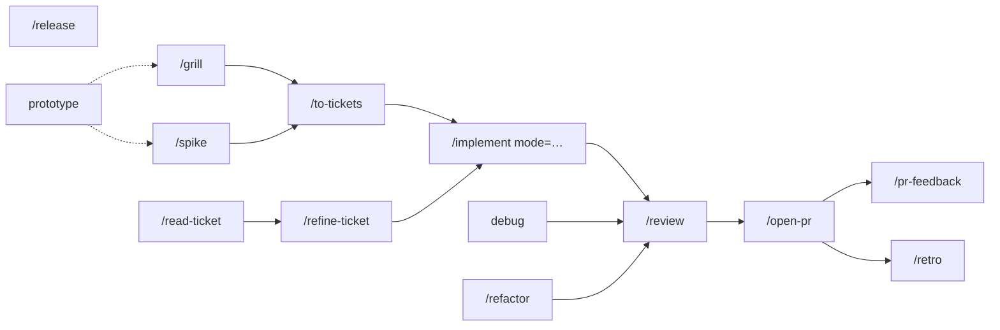
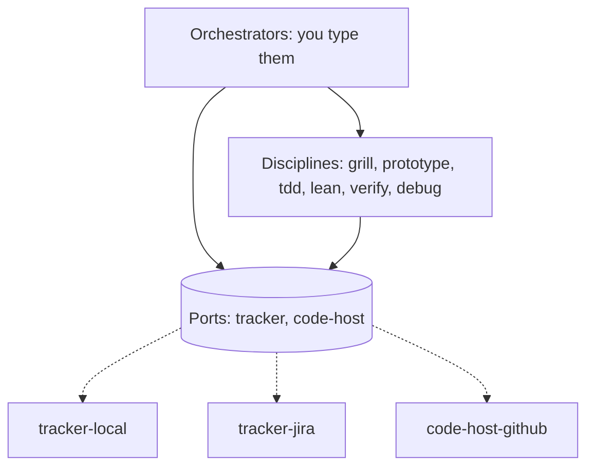

# Copilot CLI workflow skills

A tool-agnostic engineering workflow for GitHub Copilot CLI: **align → tickets → build → review → PR → learn**, with selectable autonomy, swappable tool adapters, human-readable tickets, and agent-facing briefs.

## Install

```bash
./install.sh          # copy into ~/.copilot/skills and ~/.copilot/agents
./install.sh --link   # symlink instead, so edits here apply live
```

Then, in `copilot`:

1. `/skills reload`, then `/skills list` to confirm the skills loaded.
2. `/setup-workflow` in each repo. It binds `tracker-local` until Jira access is approved.
3. `/workflow` whenever you want the map.

## Flows



Inside `/implement`, each slice goes red → green → lean → verify → commit → log. After each slice the autonomy mode decides: wait for you (collaborative), post a digest and continue (balanced), or log rulings and continue (autopilot).

## Design



- **Ports and adapters.** Skills call tracker or code-host operations, and `.agents/workflow.md` binds each port to an adapter. Moving from local tickets to Jira means changing one line, plus a one-off CSV import (`tracker-local/scripts/tickets.py export-jira-csv`).
- **Two audiences per ticket.** The ticket follows `to-tickets/ticket-template.md`: a short overview and acceptance criteria, written for humans. The agent brief (`.agents/briefs/<ref>.md`, template in `workflow/references/`) holds the detail a fresh agent needs. The ticket wins any conflict.
- **You approve what others see:** ticket creation and rewrites, PR replies under your name, and releases.
- **Overview by default.** Every slice writes a build-log entry and posts a digest. `/catch-me-up` rebuilds the big picture.
- **Lean by default.** The lean discipline and the standards reviewer push back on speculative abstractions.
- **Conventions stay out.** Stack rules (C#, TS, Tailwind) belong in `AGENTS.md` or `.github/instructions/`, which the standards reviewer reads.

See `skills/writing-skills/references/patterns.md` for the research behind each choice.

## Contents

| Kind | Items |
|---|---|
| Router and setup | `workflow`, `setup-workflow` |
| Tickets | `to-tickets` (+ ticket template), `read-ticket`, `refine-ticket` |
| Build | `implement`, `refactor`, `spike` |
| Review and ship | `review`, `open-pr`, `pr-feedback`, `release` |
| Orientation and learning | `catch-me-up`, `handoff`, `retro`, `writing-skills` |
| Disciplines (model-invoked) | `grill`, `prototype`, `tdd`, `lean`, `verify`, `debug` |
| Adapters | `tracker-local`, `tracker-jira`, `code-host-github` |
| Custom agents | `spec-reviewer`, `standards-reviewer`, `implementer` |

## Local files (gitignored by `/setup-workflow`)

`.agents/tickets/`, `.agents/briefs/`, `.agents/build-log.md` and `.agents/prototypes/`. The bindings file `.agents/workflow.md` is yours to commit or not. Never ignore `.agents/` as a whole, because Copilot loads project skills from `.agents/skills/`.
