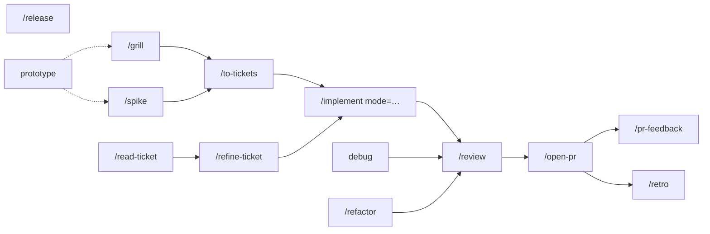
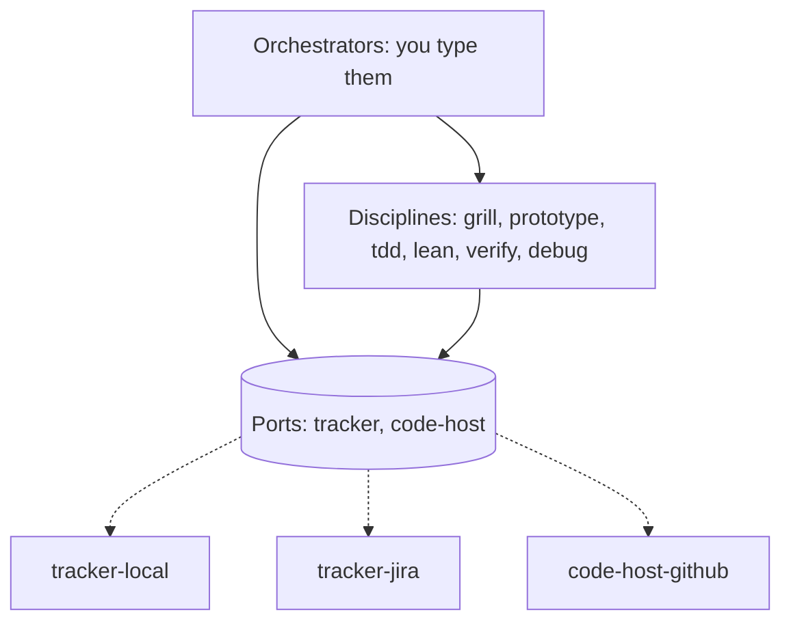

# Agent workflow skills

A harness-agnostic engineering workflow for any coding agent (GitHub Copilot CLI, Codex, Claude Code): **align → tickets → build → review → PR → learn**, with selectable autonomy, swappable tool adapters, human-readable tickets, and agent-facing briefs.

## Install

```bash
./install.sh                      # copy skills into ~/.agents/skills (Copilot CLI and Codex read it)
./install.sh --link               # symlink instead, so edits here apply live
./install.sh --harness claude     # also wire ~/.claude/skills and ~/.claude/agents
./install.sh --harness copilot    # also install the custom agents to ~/.copilot/agents
./install.sh --harness all
```

Then, in your harness:

1. Reload skills if it needs that, and confirm they are listed.
2. `/setup-workflow` in each repo. It binds `tracker-local` until Jira access is approved.
3. `/workflow` whenever you want the map.

## Plugins

The repo is also a plugin for each harness. Skills and agents are shared, so only the manifests differ.

| Harness | Manifest | Install |
|---|---|---|
| Claude Code | `.claude-plugin/` | `/plugin marketplace add JacobCGade/skills`, then `/plugin install agent-workflow@jacobcgade-skills` |
| Copilot CLI | `plugin.json`, `.github/plugin/marketplace.json` | `/plugin marketplace add JacobCGade/skills`, then `copilot plugin install agent-workflow@jacobcgade-skills` |
| Codex | `.codex-plugin/` | add the repo as a plugin source in Codex |

Keep the version in all four manifests in step.

## Flows



Inside `/implement`, each slice goes red → green → lean → verify → commit → log. After each slice the autonomy mode decides: wait for you (collaborative), post a digest and continue (balanced), or log rulings and continue (autopilot).

## Design



- **Harness-agnostic.** Skills live in `.agents/skills`, conventions in `AGENTS.md`, and nothing depends on one vendor's commands or paths. Custom agents are optional, and skills fall back to running inline when a harness has none.
- **Ports and adapters.** Skills call tracker or code-host operations, and `.agents/workflow.md` binds each port to an adapter. Moving from local tickets to Jira means changing one line, plus a one-off CSV import (`tracker-local/scripts/tickets.py export-jira-csv`).
- **Two audiences per ticket.** The ticket follows `to-tickets/ticket-template.md`: a short overview and acceptance criteria, written for humans. The agent brief (`.agents/briefs/<ref>.md`, template in `workflow/references/`) holds the detail a fresh agent needs. The ticket wins any conflict.
- **You approve what others see:** ticket creation and rewrites, PR replies under your name, and releases.
- **Overview by default.** Every slice writes a build-log entry and posts a digest. `/catch-me-up` rebuilds the big picture.
- **Lean by default.** The lean discipline and the standards reviewer push back on speculative abstractions.
- **Conventions stay out.** Stack rules (C#, TS, Tailwind) belong in `AGENTS.md`, which every harness reads (Claude Code via a `CLAUDE.md` containing `@AGENTS.md`). The standards reviewer reads it and any harness-specific instruction files.

See `skills/writing-skills/references/patterns.md` for the research behind each choice.

## Contents

| Kind | Items |
|---|---|
| Router and setup | `workflow`, `setup-workflow` |
| Tickets | `to-tickets` (+ ticket template), `read-ticket`, `refine-ticket` |
| Build | `implement`, `refactor`, `spike` |
| Review and ship | `review`, `open-pr`, `pr-feedback`, `release` |
| Orientation and learning | `catch-me-up`, `handoff`, `retro`, `writing-skills` |
| Disciplines (model-invoked) | `grill`, `prototype`, `tdd`, `lean`, `verify`, `debug` |
| Adapters | `tracker-local`, `tracker-jira`, `code-host-github` |
| Custom agents (optional) | `spec-reviewer`, `standards-reviewer`, `implementer` |

## Local files (gitignored by `/setup-workflow`)

`.agents/tickets/`, `.agents/briefs/`, `.agents/build-log.md` and `.agents/prototypes/`. The bindings file `.agents/workflow.md` is yours to commit or not. Never ignore `.agents/` as a whole, because harnesses load project skills from `.agents/skills/`.

## Harness support

| | Copilot CLI | Codex | Claude Code |
|---|---|---|---|
| Skills | `~/.agents/skills` | `~/.agents/skills` | `~/.claude/skills` (`--harness claude`) |
| Repo conventions | `AGENTS.md` | `AGENTS.md` | `CLAUDE.md` importing `AGENTS.md` |
| Custom agents | `~/.copilot/agents` (`--harness copilot`) | none, runs inline | `~/.claude/agents` (`--harness claude`) |

Skills use only `name`, `description` and `disable-model-invocation`, and say "subagent" rather than naming a harness feature. Where a harness has no subagents, review and implementation run inline from the same prompts in `~/.agents/agents/`.

## Licence

Apache 2.0. See `LICENSE`.
