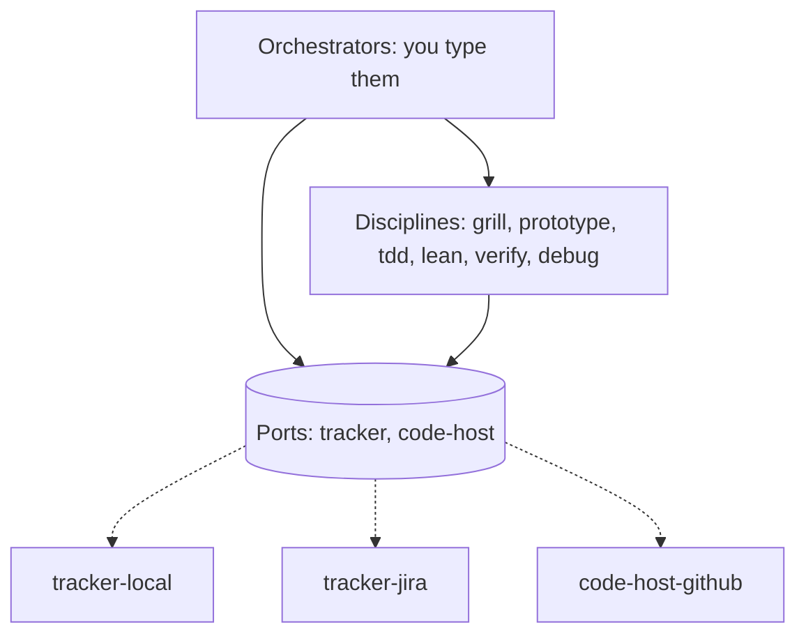

# Agent workflow skills

A harness-agnostic engineering workflow for any coding agent (GitHub Copilot CLI, Codex, Claude Code): **align → tickets → build → review → PR → learn**, with selectable autonomy, swappable tool adapters, human-readable tickets, and agent-facing briefs.

## Install

```bash
./install.sh                      # copy skills into ~/.agents/skills (Copilot CLI and Codex read it)
./install.sh --link               # symlink instead, so edits here apply live
./install.sh --harness claude     # also wire ~/.claude/skills and ~/.claude/agents
./install.sh --harness copilot    # also install the custom agents to ~/.copilot/agents
./install.sh --harness all
```

Then, in your harness:

1. Reload skills if it needs that, and confirm they are listed.
2. `/setup-workflow` in each repo. It binds `tracker-local` until Jira access is approved.
3. `/workflow` whenever you want the map.

## Plugins

The repo is also a plugin for each harness. Skills and agents are shared, so only the manifests differ.

| Harness | Manifest | Install |
|---|---|---|
| Claude Code | `.claude-plugin/` | `/plugin marketplace add JacobCGade/skills`, then `/plugin install agent-workflow@jacobcgade-skills` |
| Copilot CLI | `plugin.json`, `.github/plugin/marketplace.json` | `/plugin marketplace add JacobCGade/skills`, then `copilot plugin install agent-workflow@jacobcgade-skills` |
| Codex | `.codex-plugin/` | add the repo as a plugin source in Codex |

Keep the version in all four manifests in step.

## Workflows

Pick the situation you are in and open its section. Each workflow lists the skills to run and in what order. Commands you type start with `/`. The rest are disciplines (`tdd`, `lean`, `verify`, `debug`, `prototype`) that the agent applies on its own, so you never type them. Run `/workflow` at any time for the same map inside your agent.

<details>
<summary><strong>I'm setting up a new repo</strong></summary>

1. `/setup-workflow` binds the tracker (`tracker-local` until you have Jira access), the code host, your check commands, the autonomy default, and the gitignore entries.
2. Optionally `/setup-workflow personal` for defaults that follow you across repos.

Do this once per repo.
</details>

<details>
<summary><strong>I want to build a new feature</strong></summary>

`/grill` → `/to-tickets` → `/implement` → `/review` → `/open-pr` → `/pr-feedback` → `/retro`

1. `/grill` interviews you until no decision is left to assume. When a question needs a runnable answer, it detours through the `prototype` discipline.
2. `/to-tickets` turns the alignment into a ticket plan. It creates the tickets only after you approve the plan.
3. `/implement <ref> [mode=collaborative|balanced|autopilot]` reads the ticket, then works slice by slice. Each slice goes red → green → lean → verify → commit → log. After each slice the autonomy mode decides: wait for you (collaborative), post a digest and continue (balanced), or log rulings and continue (autopilot).
4. `/review` runs two fresh-context reviewers, one for the spec and one for the standards.
5. `/open-pr` opens the pull request with the change, the evidence and the risk.
6. `/pr-feedback` when reviewers comment. You decide on each thread, and it posts only the replies you approved.
7. `/retro` turns the session's mistakes into checks, types or sharper skills.
</details>

<details>
<summary><strong>I want to make a small change</strong></summary>

`/implement` → `/review` → `/open-pr`

Skip the tickets: run `/implement` straight from the conversation, with no ref. Add `/grill` first if the request leaves decisions open.
</details>

<details>
<summary><strong>I'm picking up a ticket someone else wrote</strong></summary>

`/read-ticket` → `/refine-ticket` (if it has gaps) → `/implement` → `/review` → `/open-pr`

1. `/read-ticket <ref>` reads the ticket with its parent, children, links and comments, checks it against the definition of ready, and writes the agent brief.
2. `/refine-ticket <ref>` interviews you on the gaps and rewrites the ticket. It writes back only after you approve.
3. `/implement <ref>`, then continue as in the feature workflow.
</details>

<details>
<summary><strong>Something is broken</strong></summary>

`debug` → `/review` → `/open-pr`

1. Describe the failure. The `debug` discipline takes over: reproduce, find the cause, then fix, with a regression test through `tdd`.
2. `/review` and `/open-pr` as usual.
</details>

<details>
<summary><strong>I want to refactor or migrate something</strong></summary>

`/refactor` → `/review` → `/open-pr`

1. `/refactor <target or ticket> [mode=…]` pins the current behaviour with tests, works in small green steps, moves callers over, then deletes the old path.
2. `/review` and `/open-pr`. Behaviour must not change, so the spec axis checks exactly that.
</details>

<details>
<summary><strong>I want to test an idea or make a proof of concept</strong></summary>

`/spike` or `prototype` → ADR or `/to-tickets`

- **A question to investigate:** `/spike <question>` is timeboxed. It ends in a cited findings note and your decision, recorded as an ADR or as tickets.
- **A question that running code answers faster than discussion** (a library's real behaviour, performance, an API's responses, how a UI flow feels): ask for a prototype. The `prototype` discipline writes throwaway code in `.agents/prototypes/`, and you keep the answer, not the code.
- If the answer says build it, go on with `/to-tickets` or the feature workflow.
</details>

<details>
<summary><strong>I want to add tests</strong></summary>

Ask for tests, or for a test-first build. The `tdd` discipline works at the seams (red → green), and `verify` makes the agent show its test run before it claims anything passes. For tests as part of a feature, use the feature workflow. They happen inside every `/implement` slice.
</details>

<details>
<summary><strong>A PR has review comments</strong></summary>

`/pr-feedback [PR]`

It proposes fix, reply or skip per thread and drafts the replies. You write the words and approve each one. Then `/implement` or `/review` for any fixes it asked for.
</details>

<details>
<summary><strong>I want to ship a release</strong></summary>

`/release [since <tag>] [version]`

It collects the merged PRs since the last tag, drafts the notes and a semver version, and publishes only after you approve.
</details>

<details>
<summary><strong>I lost track, or I'm switching sessions</strong></summary>

- **Lost track of what was built:** `/catch-me-up [since <ref> | <ticket> | today | explain <thing>]` rebuilds the overview and says where to start reading.
- **Session is full, or you're switching agents:** `/handoff [what the next session will do]` writes a document a fresh session can continue from.
</details>

<details>
<summary><strong>I want to learn from a session</strong></summary>

`/retro`

Run it in the session it covers, or pass an exported session file. It turns mistakes, corrections and slow spots into changes to the environment, most severe first.
</details>

<details>
<summary><strong>I want to change these skills or add an adapter</strong></summary>

`/writing-skills <what you want>`

It covers a new skill, a change to one, and an adapter for a new tool (Linear, GitLab and so on).
</details>

## Design



- **Harness-agnostic.** Skills live in `.agents/skills`, conventions in `AGENTS.md`, and nothing depends on one vendor's commands or paths. Custom agents are optional, and skills fall back to running inline when a harness has none.
- **Ports and adapters.** Skills call tracker or code-host operations, and `.agents/workflow.md` binds each port to an adapter. Moving from local tickets to Jira means changing one line, plus a one-off CSV import (`tracker-local/scripts/tickets.py export-jira-csv`).
- **Two audiences per ticket.** The ticket follows `to-tickets/ticket-template.md`: a short overview and acceptance criteria, written for humans. The agent brief (`.agents/briefs/<ref>.md`, template in `workflow/references/`) holds the detail a fresh agent needs. The ticket wins any conflict.
- **You approve what others see:** ticket creation and rewrites, PR replies under your name, and releases.
- **Overview by default.** Every slice writes a build-log entry and posts a digest. `/catch-me-up` rebuilds the big picture.
- **Lean by default.** The lean discipline and the standards reviewer push back on speculative abstractions.
- **Conventions stay out.** Stack rules (C#, TS, Tailwind) belong in `AGENTS.md`, which every harness reads (Claude Code via a `CLAUDE.md` containing `@AGENTS.md`). The standards reviewer reads it and any harness-specific instruction files.

See `skills/writing-skills/references/patterns.md` for the research behind each choice.

## Contents

| Kind | Items |
|---|---|
| Router and setup | `workflow`, `setup-workflow` |
| Tickets | `to-tickets` (+ ticket template), `read-ticket`, `refine-ticket` |
| Build | `implement`, `refactor`, `spike` |
| Review and ship | `review`, `open-pr`, `pr-feedback`, `release` |
| Orientation and learning | `catch-me-up`, `handoff`, `retro`, `writing-skills` |
| Disciplines (model-invoked) | `grill`, `prototype`, `tdd`, `lean`, `verify`, `debug` |
| Adapters | `tracker-local`, `tracker-jira`, `code-host-github` |
| Custom agents (optional) | `spec-reviewer`, `standards-reviewer`, `implementer` |

## Local files (gitignored by `/setup-workflow`)

`.agents/tickets/`, `.agents/briefs/`, `.agents/build-log.md` and `.agents/prototypes/`. The bindings file `.agents/workflow.md` is yours to commit or not. Never ignore `.agents/` as a whole, because harnesses load project skills from `.agents/skills/`.

## Harness support

| | Copilot CLI | Codex | Claude Code |
|---|---|---|---|
| Skills | `~/.agents/skills` | `~/.agents/skills` | `~/.claude/skills` (`--harness claude`) |
| Repo conventions | `AGENTS.md` | `AGENTS.md` | `CLAUDE.md` importing `AGENTS.md` |
| Custom agents | `~/.copilot/agents` (`--harness copilot`) | none, runs inline | `~/.claude/agents` (`--harness claude`) |

Skills use only `name`, `description` and `disable-model-invocation`, and say "subagent" rather than naming a harness feature. Where a harness has no subagents, review and implementation run inline from the same prompts in `~/.agents/agents/`.

## Licence

Apache 2.0. See `LICENSE`.
